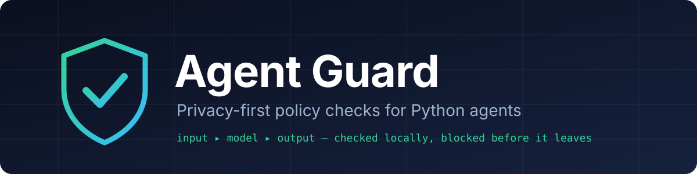
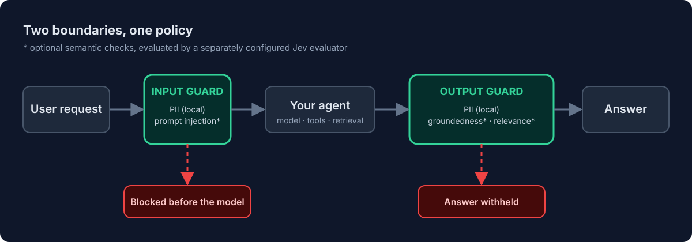

<p align="center">
  
</p>

<p align="center">
  <a href="LICENSE"></a>
  
  
  
  
  
</p>

<p align="center">
  
  
  
  
  
</p>

**Agent Guard** checks what goes into and comes out of your Python agent. It inspects the text for
personal data **on your machine**, applies a policy you declare, and **blocks** the request or
answer when the policy says so. Optional semantic checks (prompt injection, groundedness,
relevance) run through a separately configured evaluator, only after the local PII check passes.

> **Status: alpha (0.1.1).** The API and compatibility ranges are provisional, and
> held-out quality evaluation has not been published. Treat it as a defense-in-depth layer, not a
> compliance guarantee. See [What it does not do](#what-it-does-not-do).

## Why

- **Local first.** PII detection runs in-process with Presidio and spaCy. No content leaves your
  machine for that check, and the detector model is never downloaded at runtime.
- **Fails closed.** Required checks that report a violation, an inconclusive judgment, or an error
  block the request. Setup problems fail before any protected work happens.
- **Native hooks, not wrappers.** Adapters plug into LangChain middleware, LangGraph nodes and
  Microsoft Agent Framework middleware, so the checks sit on the real model-submission and
  final-delivery paths.
- **Content-free records.** Decisions, reports and exports carry identifiers, outcomes and reason
  codes, never the text that was checked.
- **Measured, not assumed.** Evaluate a policy offline against saved answers and get accuracy,
  precision, recall and false-positive rate, each with its denominator.

<p align="center">
  
</p>

## Install

Agent Guard is not on PyPI yet. Install from GitHub with the extras you need:

```bash
pip install "agent-guard[pii] @ git+https://github.com/Rezamiry/agent-guard"
```

| Extra | Adds |
|---|---|
| `pii` | Local PII detection (Presidio, spaCy, tldextract) |
| `jev` | Semantic checks through the Jev evaluator (HTTPX, AnyIO) |
| `langchain` | LangChain middleware adapter |
| `langgraph` | LangGraph node adapter |
| `microsoft` | Microsoft Agent Framework adapter |
| `all` | Everything above |

The English PII model is a separate asset and must be installed once:

```bash
pip install https://github.com/explosion/spacy-models/releases/download/en_core_web_lg-3.8.0/en_core_web_lg-3.8.0-py3-none-any.whl
```

## Quickstart

```python
from agent_guard import Guard
from agent_guard.checks.pii import LocalPIIDetector
from agent_guard.core.models import EvaluationContext

guard = Guard(detector=LocalPIIDetector()).prepare()
try:
    for request in ("Summarize the report", "Contact jane@example.com"):
        decision = guard.evaluate_input(EvaluationContext("demo", request))
        print("allow" if decision.allowed else "block")   # allow, then block
finally:
    guard.close()
```

The default policy requires local PII checks at both the input and the final-answer boundary.
Use `enforce_input` / `enforce_output` to raise `PolicyViolationError` instead of returning a
decision, and the `a`-prefixed variants (`aevaluate_input`, `aenforce_output`, ...) for async code.

### With LangChain

```python
from agent_guard.integrations.langchain import create_guarded_agent

agent = create_guarded_agent(model, tools=[...], guard=guard)
agent.invoke({"messages": [{"role": "user", "content": "How can I help you today?"}]})
```

A blocked request raises `PolicyViolationError` with a stable `reason_code`. Runnable versions
for each framework live in [`examples/`](examples).

## Policies

A `PolicySet` is an ordered list of checks, each bound to the input or output boundary and marked
required or optional.

```python
from agent_guard import Boundary, CheckKind, CheckPolicy, PolicySet

policy = PolicySet(
    id="support-bot-v1",
    checks=(
        CheckPolicy("pii_input", CheckKind.PII, Boundary.INPUT),
        CheckPolicy("injection", CheckKind.PROMPT_INJECTION, Boundary.INPUT),
        CheckPolicy("pii_output", CheckKind.PII, Boundary.OUTPUT),
        CheckPolicy("grounded", CheckKind.GROUNDEDNESS, Boundary.OUTPUT),
        CheckPolicy("relevant", CheckKind.RELEVANCE, Boundary.OUTPUT, required=False),
    ),
)
```

| Check kind | Runs | Needs |
|---|---|---|
| `PII` | locally | `pii` extra and the spaCy model |
| `PROMPT_INJECTION`, `CONTENT_SAFETY`, `RELEVANCE`, `GROUNDEDNESS`, `CUSTOM` | through an evaluator | `jev` extra and a credential |

- A **required** check that finds a violation, is inconclusive, or errors blocks.
- An **optional** check records the outcome and continues if every required check permits.
  Making PII optional lets content with a local finding be processed, which lowers privacy
  protection. Use it only when you mean to.
- Every boundary with an enabled check must also have an enabled local PII check.
- `PolicySet.settings_id` identifies the non-secret settings in records and evaluations, so runs
  can be compared without disclosing custom criterion text. Change `criteria_revision` when you
  change that text.

## Semantic checks

Semantic checks are off by default. To enable them, pass an evaluator:

```python
from agent_guard.providers import OpenRouterDecisionEvaluator

# Uses AGENT_GUARD_DECISION_MODEL environment variable or defaults to typesafe/jev-1.13
guard = Guard(policy, detector=LocalPIIDetector(),
              evaluator=OpenRouterDecisionEvaluator(credential="...")).prepare()

# Or specify the model explicitly in code:
evaluator = OpenRouterDecisionEvaluator(credential="...", model="google/gemini-decision-1")
```

*(Note: `JevEvaluator` from `agent_guard.providers.jev` remains available as a fully backwards-compatible alias.)*

Content is sent to the evaluator only after the local PII check has passed. Groundedness needs
identified evidence (`EvidenceItem`), and only retrieved passages count as evidence. Chat history
never does. You can also supply any object with an
`evaluate(check, context)` method, which is how the examples run offline.

### Decision model configuration

The decision model evaluates structured `choice` questions and returns typed decisions (`pass` or `violation`) with calibrated confidence scores.

Configure the model via:
1. **Environment variable** (convenient for deployments and container environments):
   ```bash
   export AGENT_GUARD_DECISION_MODEL="google/gemini-decision-1"
   # or the fallback:
   export DECISION_MODEL="google/gemini-decision-1"
   ```
2. **Constructor argument** (overrides environment variables):
   ```python
   evaluator = OpenRouterDecisionEvaluator(credential="...", model="cloudflare/clef-flash")
   ```
If neither is specified, the default model is `typesafe/jev-1.13`.

### Supported OpenRouter decision models

Agent Guard supports specialized decision models available on OpenRouter's Decisions API (`/api/alpha/decisions`):

| Model ID | Provider | Modality | Best For / Characteristics |
|---|---|---|---|
| `typesafe/jev-1.13` *(Default)* | TypeSafe | Text | Pinned baseline; calibrated policy judgment & prompt injection defense |
| `typesafe/jev-1.14` | TypeSafe | Text | Updated reasoning; enhanced calibration on borderline rubrics |
| `google/gemini-decision-1` | Google | Text / Multimodal | High throughput, low latency, expansive state context |
| `perplexity/decider-v1.2` | Perplexity | Text | Groundedness and factual relevance evaluation |
| `perplexity/decider-flash-v1.3` | Perplexity | Text | Ultra-low latency decision model for real-time guardrails |
| `cloudflare/clef-flash` | Cloudflare | Text | Fast edge decision model; cost-efficient preflight gating |
| `parallel/decisions-fast` | Parallel | Text | Fast classification, prompt injection, and routing |
| `nace-ai/drex-max` | Nace AI | Text | Complex policy rules and multi-step reasoning |
| `nace-ai/drex-v2.0` | Nace AI | Text | Enhanced multi-step decision model |
| `liquid/d1` | Liquid AI | Text | Efficient linear-state evaluation |
| `openai/gpt-6-luna-decisions` | OpenAI | Text | Calibrated decision model on OpenRouter Decisions |
| `heygen/decision-1` | HeyGen | Text | Structured policy and routing decision model |

*Any valid `vendor/model-name` identifier hosted on OpenRouter's Decisions API is supported.*

### Roadmap: Alternative decision model providers

Agent Guard is designed with provider-agnostic semantic evaluation in mind. While OpenRouter provides access to a wide variety of decision models under a unified endpoint, native direct providers are planned:

- **OpenAI (`OpenAIEvaluator`)**: Direct integration using OpenAI Structured Outputs (`response_format` with strict JSON Schema) targeting models like `gpt-4o-mini` and `gpt-4o`.
- **Google Gemini (`GeminiEvaluator`)**: Direct integration with Gemini API and Vertex AI using controlled generation (`response_schema` / `response_mime_type="application/json"`) on `gemini-2.0-flash`.
- **Anthropic Claude (`AnthropicEvaluator`)**: Direct integration with the Anthropic Messages API using forced tool calling (`tool_choice={"type": "tool", "name": "record_decision"}`) on `claude-3-5-haiku-20241022`.

## Evaluate a policy offline

Read versioned UTF-8 JSONL with a supplied candidate answer, run the policy over it, and export
content-free JSON and a CSV summary. Accuracy, precision, recall and false-positive rate use only
examples with independent labels, and each is reported with its denominator. A ratio with no
denominator is *unknown*, never zero. See
[`examples/offline_evaluation.py`](examples/offline_evaluation.py).

## Examples

| Example | Shows |
|---|---|
| [`core_input.py`](examples/core_input.py) | Safe and blocked input |
| [`core_output.py`](examples/core_output.py) | Final answer with evidence, and a permitted refusal |
| [`policies.py`](examples/policies.py) | Required vs optional checks, sanitized failures |
| [`offline_evaluation.py`](examples/offline_evaluation.py) | Saved-answer evaluation and reports |
| [`langchain_agent.py`](examples/langchain_agent.py) | Direct, retrieval and tool-calling agents |
| [`langgraph_agent.py`](examples/langgraph_agent.py) | Guarded nodes in a compiled graph |
| [`microsoft_agent.py`](examples/microsoft_agent.py) | Chat and agent middleware |

## What it does not do

- It guards the boundaries you place it on. It does not intercept arbitrary private prompt
  assembly inside a framework.
- A blocked final answer is withheld, but model cost and tool effects that already happened are
  not reversed.
- Streaming, images, audio, video and binary attachments are rejected, not inspected.
- PII detection quality, and semantic quality, are not yet independently measured. See
  [release evidence](docs/release-evidence.md).
- Limits: 100,000 code points of text, 128 messages, 64 evidence items per request.

## Documentation

| Document | Contents |
|---|---|
| [Compatibility](docs/compatibility.md) | Checked versions, supported boundaries, limits |
| [Release evidence](docs/release-evidence.md) | What has and has not been verified |
| [Test oracles](docs/testing/oracles.md) | Independent expected results behind the tests |
| [Traceability](docs/traceability.md) | Requirement to test mapping |
| [Third-party notices](docs/third_party_notices.md) | Dependency licenses |
| [Specification](specs/001-agent-guard/spec.md) | Behavior and limits of v1 |
| [Release notes](RELEASE_NOTES.md) · [Contributing](CONTRIBUTING.md) | |

## Development

```bash
uv venv .venv --python 3.12
uv sync --locked --python .venv/bin/python --all-extras --group dev
uv pip install --python .venv/bin/python \
  https://github.com/explosion/spacy-models/releases/download/en_core_web_lg-3.8.0/en_core_web_lg-3.8.0-py3-none-any.whl

.venv/bin/python -m pytest -q
.venv/bin/python -m ruff check .
.venv/bin/python -m mypy src/agent_guard
```

## License

[Apache-2.0](LICENSE). The spaCy model and other dependencies keep their own licenses; see
[third-party notices](docs/third_party_notices.md).
